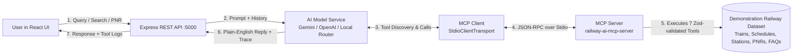

# Railway AI Assistant

A beginner-friendly, full-stack web application that combines **React**, **Tailwind CSS**, **Node.js + Express**, **AI (Gemini / OpenAI)**, and the official **Model Context Protocol (MCP) SDK** to help railway passengers search trains, view route timetables, inspect station details, plan journeys, track bookings & simulated train positions using **10-digit PNR / PR numbers**, and chat with an intelligent AI assistant.

> **Important Notice (Demonstration Data):** All trains, schedules, fares, availability statuses, PNR / PR records, and simulated running positions in this project are **demonstration sample data**. The application does **not** connect to live IRCTC or NTES servers and does not pretend to offer real-time IRCTC ticket availability.

---

## 1. Problem Statement

Railway passengers often need to navigate multiple disconnected screens to search trains, verify intermediate stops, check station amenities, look up PNR / PR booking details, and understand railway rules (Tatkal timings, RAC/WL upgrades, luggage limits, TDR refunds). Traditional chatbots frequently hallucinate schedules or lack direct access to structured railway data.

## 2. Objectives

- Provide a modern, responsive railway dashboard for searching trains, checking schedules, exploring stations, and tracking PNR / PR numbers.
- Connect an AI assistant to structured railway tools using the official **Model Context Protocol (`@modelcontextprotocol/sdk`)** over `StdioServerTransport` rather than hardcoded fake responses.
- Show complete transparency into **how AI interacts with external tools** (tool name, input JSON parameters, status, execution latency, and raw JSON output).
- Keep all API keys securely stored in `backend/.env` and never expose secrets in frontend code.

---

## 3. Technologies Used

| Layer | Technology |
| --- | --- |
| **Frontend** | React 19, Vite, Tailwind CSS v4, Lucide Icons |
| **Backend** | Node.js, Express 5, CORS, dotenv |
| **MCP Protocol** | `@modelcontextprotocol/sdk` (`McpServer`, `Client`, `StdioServerTransport`, `StdioClientTransport`), Zod |
| **AI Integration** | Google Gemini API or OpenAI API (via native `fetch` function calling) + Local MCP Router fallback |
| **Testing** | Node.js built-in test runner (`node --test`) |

---

## 4. Architecture Diagram



### End-to-End Request Flow

```text
User → AI Model → MCP Client → MCP Server → MCP Tool → Result → AI Response
```

1. **User** asks a question (e.g., *"Track PNR 4521896304"* or *"Find trains from MMCT to NDLS"*) or uses the Search / Tracker UI.
2. **AI Model** inspects the available tools discovered from the MCP server and decides which tool(s) and arguments to call.
3. **MCP Client** (`backend/src/mcp/client.js`) sends a JSON-RPC `tools/call` request over `StdioClientTransport`.
4. **MCP Server** (`backend/src/mcp/server.js`) validates inputs with Zod and invokes the matching handler.
5. **MCP Tool** runs (`search_trains`, `get_train_schedule`, `get_station_information`, `plan_journey`, `railway_faq`, `track_by_pnr`, or `get_train_running_status`).
6. **Result** is returned as structured JSON back through the MCP Client to the AI Model.
7. **AI Response** translates the tool output into clear, simple English and displays the execution trace in the UI.

---

## 5. What Is Model Context Protocol (MCP) & How AI Connects to It

**Model Context Protocol (MCP)** is an open standard created to let AI models discover and invoke external tools, APIs, and data sources in a consistent, schema-validated way.

- Instead of writing custom prompt hacks for every backend function, our **`railway-ai-mcp-server`** registers tools using `server.registerTool(name, { description, inputSchema }, handler)`.
- Our **`railway-ai-backend-client`** launches the MCP server as a child process over standard input/output (`StdioClientTransport`), discovers tools with `client.listTools()`, and converts those JSON Schemas into tool declarations for Gemini or OpenAI.
- When the LLM returns a `functionCall` / `tool_calls` decision, the backend executes `client.callTool({ name, arguments })` against the real MCP server and feeds the result back to the AI to craft the final answer.
- If no external AI API key is configured yet, the backend automatically uses its **Local MCP Tool-Router** so beginners can still test real MCP Client ↔ MCP Server communication immediately.

### Implemented MCP Tools (7 Total)

1. `search_trains` — Search demonstration trains between source and destination stations (supports codes, city names, dates, and class filters).
2. `get_train_schedule` — Retrieve full route timetable, intermediate stops, arrival/departure times, halts, platforms, and distances.
3. `get_station_information` — Get station zone, platform count, passenger amenities, and serving trains.
4. `plan_journey` — Suggest fastest or budget direct trains, or 1-stop connecting journeys.
5. `railway_faq` — Answer common railway questions (PNR/RAC/WL, Tatkal timings, charting, luggage limits, cancellation/TDR, helpline `139`).
6. `track_by_pnr` — Look up a 10-digit PNR / PR number for demonstration passenger booking status and linked train running simulation.
7. `get_train_running_status` — Retrieve simulated current station, delay status, route progress percentage, and upcoming halts for a train number or PNR.

---

## 6. Project Structure

```text
indian railways project/
├── package.json                  # Root helper scripts (install, dev, build, test)
├── README.md                     # Documentation
├── scripts/
│   └── dev.js                    # Starts backend + frontend together
├── backend/
│   ├── package.json
│   ├── .env.example              # Environment variable template
│   ├── src/
│   │   ├── server.js             # Express app entry point
│   │   ├── config/env.js         # Loads .env safely
│   │   ├── data/railwayData.js   # Sample trains, stations, PNRs, FAQs (demo)
│   │   ├── mcp/
│   │   │   ├── server.js         # Official MCP Server (@modelcontextprotocol/sdk)
│   │   │   └── client.js         # Official MCP Client (StdioClientTransport)
│   │   ├── services/
│   │   │   ├── railwayService.js # Railway search, schedule, PNR & FAQ logic
│   │   │   └── aiService.js      # Gemini / OpenAI tool-calling + local fallback
│   │   ├── routes/api.js         # Validated REST API routes
│   │   └── middleware/errorHandler.js
│   └── tests/
│       ├── mcp.test.js           # Real MCP stdio tests for all 7 tools
│       └── api.test.js           # REST API, validation, PNR & chat tests
└── frontend/
    ├── package.json
    ├── vite.config.js            # Proxies /api to http://localhost:5000
    └── src/
        ├── App.jsx
        ├── services/apiClient.js
        └── components/
            ├── Navbar.jsx
            ├── HeroDashboard.jsx
            ├── TrainSearch.jsx
            ├── PnrTracker.jsx
            ├── StationExplorer.jsx
            ├── AiChatbot.jsx
            └── McpFlowPanel.jsx
```

---

## 7. Installation & Setup (Beginner Guide)

### Prerequisites

- **Node.js v18+** (tested on Node v26)
- **npm** (note for Windows PowerShell users: if `npm` gives an execution policy error for `npm.ps1`, use `npm.cmd` instead of `npm`!)

### Step 1: Install Dependencies

From the project root folder:

```powershell
npm.cmd run install:all
```

Or install each folder manually:

```powershell
cd backend
npm.cmd install
cd ..\frontend
npm.cmd install
```

### Step 2: Configure the AI API Key (`backend/.env`)

1. Copy `backend\.env.example` to `backend\.env`:
   ```powershell
   Copy-Item backend\.env.example backend\.env
   ```
2. Open `backend\.env` and add **either** a Google Gemini API key **or** an OpenAI API key:
   ```env
   PORT=5000
   FRONTEND_ORIGIN=http://localhost:5173
   LLM_PROVIDER=auto
   GEMINI_API_KEY=your_gemini_api_key_here
   GEMINI_MODEL=gemini-2.5-flash
   ```
   > **Note:** Even if you leave both API keys blank while getting started, the project still runs in **Local MCP Tool-Router Mode** and executes every query through the real MCP Client and MCP Server.

---

## 8. How to Run the Project

### Option A: Run Backend + Frontend Together (Recommended)

From the root folder:

```powershell
npm.cmd run dev
```

- **Frontend UI:** `http://localhost:5173`
- **Backend API:** `http://localhost:5000`

### Option B: Run in Separate Terminals

Terminal 1 (Backend + MCP Client/Server):
```powershell
cd backend
npm.cmd run dev
```

Terminal 2 (Frontend React + Vite):
```powershell
cd frontend
npm.cmd run dev
```

Terminal 3 (Optional — inspect/run the standalone MCP server over stdio):
```powershell
cd backend
npm.cmd run mcp
```

---

## 9. Testing & Sample Test Cases

Run the automated test suite (tests all 7 MCP tools over real stdio transport, REST API endpoints, validation, PNR tracking, and chatbot orchestration):

```powershell
npm.cmd test
```

### Sample Manual Test Cases to Try in the Browser

| Feature | Sample Input | Expected Outcome |
| --- | --- | --- |
| **Train Search** | Source: `MMCT`, Destination: `NDLS`, Date: `2026-11-26` | Shows `12951 Mumbai Central - New Delhi Tejas Rajdhani Express` with timings, duration, and demo classes (`1A`, `2A`, `3A`). |
| **PNR / PR Tracking** | PNR: `4521896304` or `8291045623` or `3904812756` | Displays passenger booking status (`CNF` / `RAC` / `WL`) plus linked train simulated running location, delay, and route timeline. |
| **Train Status Lookup** | Train No.: `22436` or `12723` | Shows simulated current station, next halt ETA, and progress percentage. |
| **AI Chatbot + MCP Trace** | *"Track PNR 4521896304"* or *"Plan a journey from SC to TPTY"* | AI replies in plain English and shows the MCP tool trace (`track_by_pnr` / `plan_journey`), input JSON, latency, and JSON result. |
| **MCP Playground** | Open **MCP Architecture** tab → select `get_station_information` → `{"stationQuery": "NDLS"}` | Executes the real MCP tool via `StdioClientTransport` and renders the JSON output. |
| **Input Validation** | Search `NDLS` → `NDLS` or PNR `12345` | Displays a clear validation error message instead of crashing. |

---

## 10. Future Improvements

- Connect a verified Indian Railways partner API (such as RapidAPI / RailYatri / official IRCTC/CRIS feeds) behind environment variables for live train running data.
- Add multi-language AI responses (Hindi, Telugu, Tamil, Bengali, Marathi) using user-selected language preferences.
- Persist chat conversations and favorite routes in SQLite or PostgreSQL.
- Expose an additional Streamable HTTP MCP transport alongside stdio for remote MCP clients.
